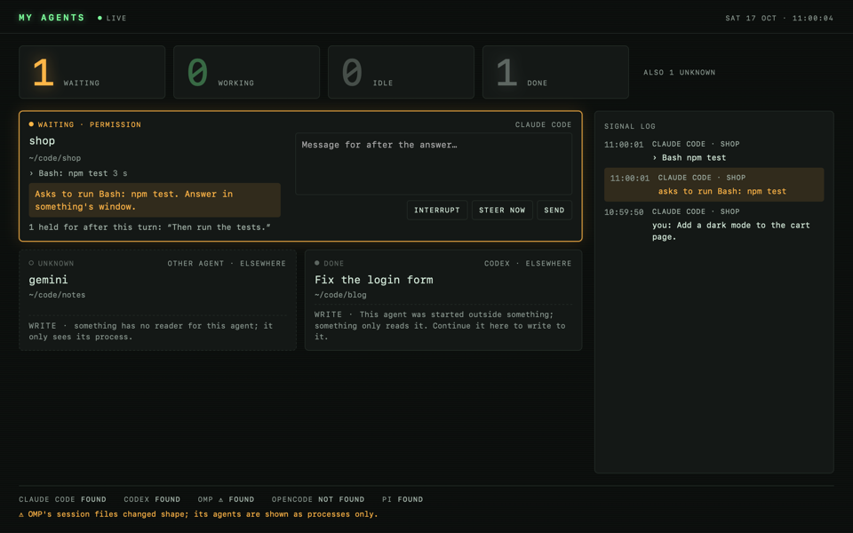
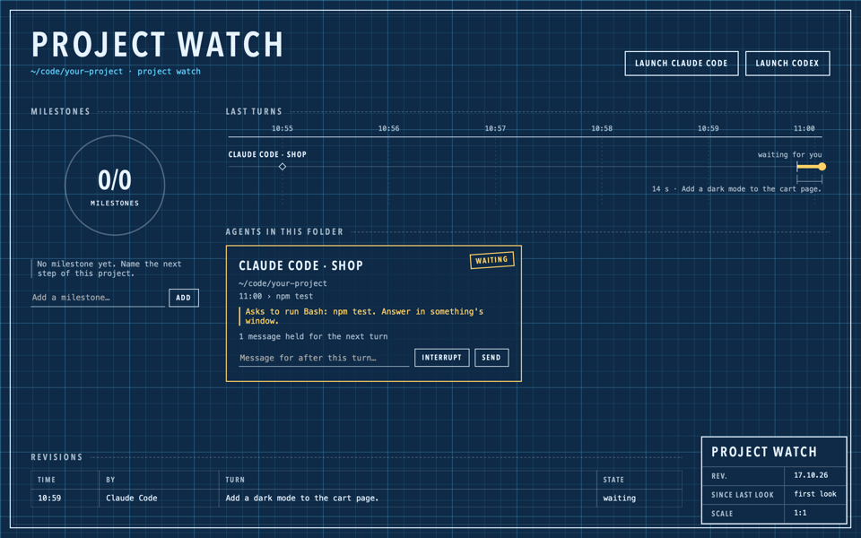
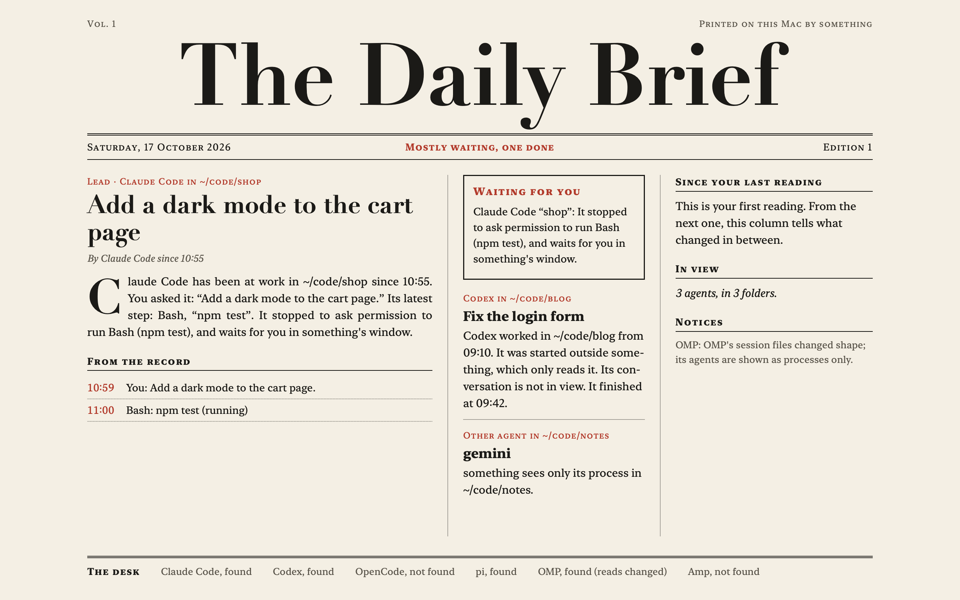
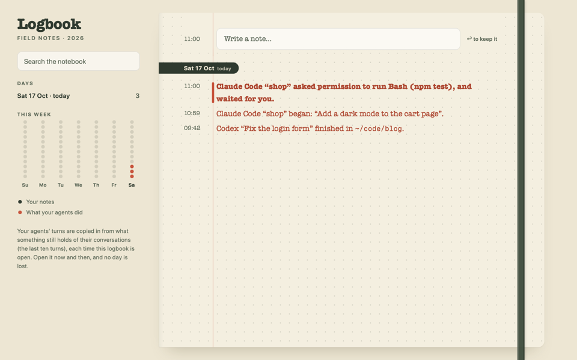
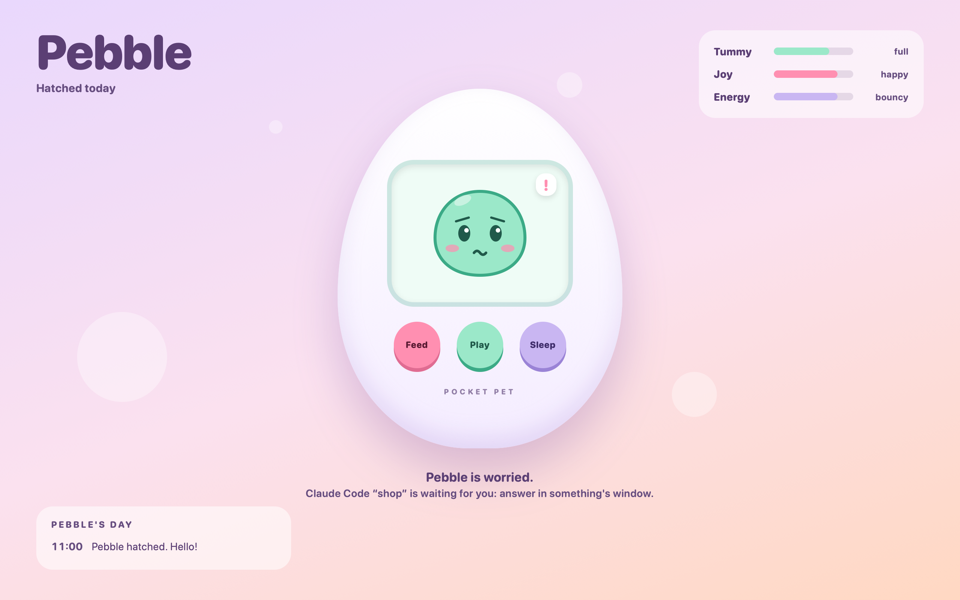

# something

something is a Mac app for **spaces**: pages you build with your own coding agent, such as a board of who is waiting
for you, a morning paper of what your agents did or a small game for your breaks. something shows them safely, and
lets them see the coding agents on your Mac (Claude Code, Codex, OpenCode, pi, OMP) and talk to the first four.

*Version 0.2. Until its tag `v0.2.0` is published, the install builds from source (`--HEAD`, a few minutes) and
updates with `brew upgrade --fetch-HEAD something`.*

## The first five minutes

You need a Mac with macOS 15 or later and [Homebrew](https://brew.sh), and no Xcode: Homebrew pours a version built
in advance for your Mac (a "bottle"), or where none fits, builds one with Apple's Command Line Tools alone.

```sh
brew install --HEAD emiwltz/tap/something    # until v0.2.0; builds from source, a few minutes
something
```

`something` opens its window. The first time, a short tour says what something is, then asks which of your installed
coding agents builds your spaces with you (it starts none of them). It also offers a small launcher in `~/Applications`
so that Spotlight, which does not look where Homebrew installs apps, finds something.

The tour ends on the blank page (New Space, ⌘N): **What do you want to make?** Describe the space, or click a
suggestion such as "Who is waiting for me", and your agent builds it. It opens by itself when ready, and a sheet asks
you what it may do. Ask for changes in the bar at the bottom of the window: the space reloads as your agent saves it.

Your agent must be installed and signed in as you use it in Terminal (`claude`, `opencode`, `pi`): something uses
your own account and settings. While Claude Code cannot reach its model, the line above the bar says so as it
retries. With none, the bar's How to Get One lists the commands that install one; the templates work without an
agent.

## Six templates

Templates (⇧⌘T) are finished spaces to start from. Use Template makes a copy that is yours to change (Project watch
first asks which folder it follows); from a terminal, `something new <name> --from <template>` does the same.

<table><tr>
<td width="33%"><br><b>My agents</b>: who works, who waits for you, and a word to each.</td>
<td width="33%"><br><b>Project watch</b>: one folder's progress, and the agents working in it.</td>
<td width="33%"><br><b>Daily brief</b>: what your agents did, like a morning paper.</td>
</tr><tr>
<td><br><b>Logbook</b>: your notes and your agents' days, day by day.</td>
<td><br><b>Stack</b>: a one-key game for your breaks.</td>
<td><br><b>Pebble</b>: a little creature that lives to the rhythm of your agents.</td>
</tr></table>

## Your assistant

The bar at the bottom of the window talks to your own coding agent, which builds and changes spaces with you: Claude
Code, OpenCode or pi, the one you choose among those installed (Codex can't build spaces yet: inside its sandbox
`something check` cannot load a page). It starts at your first message and works in `~/something/spaces`, with your
account and settings. Each message starts with a line from something saying which space is open, so "make it blue"
means that one. ⌘K types to it, ⌘J shows the conversation, ⌘. stops it. After 30 minutes without a turn it is stopped
to save memory; a new conversation starts each time something starts.

something never answers for you. Your assistant may change your spaces and run something's own commands without
asking; everything else it does asks you, as your agent's own settings decide.

For Claude Code, "without asking" is exactly: edits and writes in `~/something/spaces`, and the commands
`something new`, `check`, `open` and `guide`. For OpenCode nothing is added: it asks as your own OpenCode settings say.
pi never asks, by design: it can run any command on your Mac, and the tour and the bar say so. "Ask Before Every
Change", in the bar's agent menu, turns the exception off from the next conversation. No space can see what you say
to your assistant, or write to it.

To tell it what something is, something writes `AGENTS.md` and `CLAUDE.md` into `~/something/spaces` at each start. A
file whose first line you removed is yours: something leaves it alone.

## What it reads, and never writes

something reads, and never writes, each agent's own files: `~/.claude` or `$CLAUDE_CONFIG_DIR` (Claude Code), `~/.codex`
or `$CODEX_HOME`, with its databases in `$CODEX_SQLITE_HOME` when set (Codex), OpenCode's database (in
`~/.local/share/opencode`, or `$OPENCODE_DB`), `~/.pi` and the folders `$PI_CODING_AGENT_DIR` and
`$PI_CODING_AGENT_SESSION_DIR` name (pi), and `~/.omp` (OMP). It opens them read-only and takes only what a space is
shown: the folder, the state, the last messages, what the agent waits for. Nothing it reads from an agent goes into an
export. It also looks at the list of running processes, to tell an agent that runs from one that ended.

something writes no hook, no MCP server, no skill and no setting into any agent's configuration. What it writes is its
own: `~/something/` (your spaces, their memory, and your assistant's `AGENTS.md` and `CLAUDE.md`) and
`~/Library/Application Support/something/` (your answers to the rights sheets, the window's memory, the journals of
what spaces asked agents to do, and plan B's spool, below).

## What it launches, and how

Your assistant, and the agents a space with the right to launch starts in the folder you chose, run through each
agent's own official channel, with your own configuration:

- **Claude Code**: `claude -p --input-format stream-json --output-format stream-json --verbose
  --permission-prompt-tool stdio`, the channel Anthropic's SDKs use, without `ANTHROPIC_API_KEY` or
  `ANTHROPIC_AUTH_TOKEN` from your environment, so that it uses the account you signed in with. A Claude Code that
  refuses that option is launched again with a permission hook given in `--settings` for that launch only, which waits
  for the same window (plan B); nothing is written in your Claude settings. Your assistant also gets `--allowedTools`
  with the rules above, unless Ask Before Every Change is on.
- **Codex**: `codex app-server`, its official JSON-RPC channel, one private server per conversation. something never
  joins the server a Codex in your terminal may share.
- **OpenCode**: `opencode acp`, the Agent Client Protocol. One conversation per program.
- **pi**: `pi --mode rpc`, its official channel.
- **OMP** is read, never launched.

Started from a terminal, something gives the agents that terminal's environment, so they find the programs your
terminal finds (less the variables that only say where the terminal runs, such as `TMUX`); started from Finder or
Spotlight, it asks your login shell for its `PATH`. Closing the window keeps something running, with its agents: its
Dock icon or `something` shows the window again. Quitting stops the agents it launched, after asking you.

## Permissions and the windows of the Mac

Every decision is yours, in a window of the Mac that a space cannot draw, imitate or answer:

- **Rights.** At the first opening of a space, a sheet lists what it declares (see your agents, write to them, start
  them, remember things), each to allow or not, and the folder its agents will work in. Your answers are kept, and
  something asks again only for what the space adds. Info (⌥⌘I) shows each right of the open space with a switch to
  revoke it, Ask Again under a refused one, and the space's activity: each time it wrote to, started or changed an
  agent, or opened a link.
- **Permissions.** Each permission an agent something launched asks for opens a panel: "Allow Once" or "Deny"
  (Escape denies). There is no "always". A question from an agent opens a panel with its choices. A space sees that the
  agent waits, and can never answer for you. A hook you installed in an agent yourself stays, and may decide a
  permission before the panel opens; the state says so when the agent's own stream tells it.
- **Modes.** A mode that makes an agent ask less (accepting edits by itself) always asks you again, with the agent's
  folder. A mode that never asks (Claude's `bypassPermissions`) and a mode something does not know are refused.
- **Links.** A link you click in a space, or one it opens, shows "Open", "Cancel" or "Block Links Until Reload", one
  at a time.
- **Export.** Exporting a space carries its memory only if you choose "With Its Data", after seeing its keys and size.

## No network for spaces

A space loads only its own files, served at `something://space/`, inline code, `data:` and `blob:`. Every other address
is blocked, four times: a sandboxed frame, a content security policy on every file, a content rule list, and a
navigation policy that cancels every page change outside the space. `window.open` opens nothing. The app itself opens
no port, listens on nothing and sends no telemetry.

One gap is known. When you click with the mouse on a link that opens a new window (`target="_blank"`) inside a
closed shadow root written in HTML (a part of a page hidden from scripts outside it; one a script makes with
`attachShadow` is opened by something), WebKit may look up the link's server name and open one connection to it before
it refuses the window. No request is sent, but the page chooses the name, so it could put a few words in it. Every
other link you click, and every link a page's own script activates, is stopped before any connection.

## The contract for spaces

What a space can rely on is contract 1, written for the agent that builds spaces in the guide,
[share/guide.md](share/guide.md), which is installed with the app (`something guide` prints its path, `something
guide --print` prints it; Help › Guide for Coding Agents shows it in Finder). It holds:

- **the declaration**: a `<script type="application/json" id="something">` block in the page (or `something.json` in a
  folder space), with `contract`, `title`, `description`, `agents`, `rights`, `folder`;
- **the rights**: `state`, `send`, `launch`, `store`, each limited to one kind with `:claude`, `:codex`, `:opencode`
  or `:pi`;
- **the bridge**, `something.js`, injected into every space: `contract`, `granted`, `state`, `on`, `send`,
  `interrupt`, `set`, `launch`, `resume`, `store.get`, `store.set`, `open`;
- **the state**: `contract`, `at`, `kinds`, `agents`, `threads`, `requests`, where what is not known is `null`;
- **the codes** of every refusal and of `something check`, each with a sentence that says what to do, and **the export
  format**, a `.something` file.

The same contract as data, read by the tests: [share/contract/](share/contract/). Within contract 1, keys, functions,
rights, words and codes are only added, never renamed or removed. To build spaces with an agent outside something,
give it the guide; the skill next to it ([share/skill/SKILL.md](share/skill/SKILL.md)) is yours to add to your agent:
something never adds anything to your agents.

## The command

```text
something                       start something, or bring it to the front
something open <name>           open a space of ~/something/spaces; or import an export (a .something file)
something new <name> [--folder] make a space from the empty template (with --folder, <name>/index.html)
something new <name> --from <t> make a space from a template: agents, project, brief, logbook, stack, pet
something guide [--print]       where the guide for the coding agent that writes your spaces is; --print prints it
something check <name|path> [--json] [--refuse <right>]... [--state <file>] [--journal]
                                test a space as the app loads it, unseen, against an invented state
something --version
```

Every failure is one sentence that says what to type next. The status is 0 when it worked, 1 when it was refused or
failed, 2 when the words were wrong; `check` has its own: 0 no error, 1 errors, 2 it could not run. `check` loads the
space with the app's own lock and bridge, in a window nobody sees, against the invented state of
`share/contract/state-example.json`, never your agents, and writes a snapshot to `$TMPDIR/something-check/`.

something opens spaces by name, from `~/something/spaces` only, where each has its memory and its journal: copy a
page from elsewhere there first. A page of that folder without a declaration is listed as "not a space yet". One space
is open at a time, and it reloads when one of its files changes. A space's context menu has Show in Finder, Export…
and Move to Trash… (its memory goes with it); File › Import Space… takes an export.

## What each agent allows, and why

| | send | steer | queue | interrupt | model | mode | effort |
|---|---|---|---|---|---|---|---|
| Claude Code | yes | yes | yes | yes | yes | yes | yes |
| Codex | yes | yes | yes | yes | yes | yes | yes |
| OpenCode | yes | no | yes | yes | yes | yes | yes |
| pi | yes | yes | yes | yes | yes | no | yes |

- **OpenCode cannot steer** (take a message during a turn): its channel has no way to. A message waits for the next
  turn. OpenCode launched by something cannot ask a question either.
- **pi has no mode, and never asks permission**, by design: it runs commands and edits files without asking you
  first. The rights sheet says so when a space asks to launch pi.
- **OMP is only read, and an agent started elsewhere is read-only**: something has no channel into a terminal it did
  not open. A Claude Code or Codex conversation can be continued in something ("continue here") once no other process
  holds it; OpenCode, pi and OMP conversations cannot.

## Where it has run

something requires macOS 15 or later. The suite has run on macOS 27 with the Command Line Tools 27 alone (Swift 6.4, no
Xcode); at each push GitHub runs it on macOS 15.7 (Swift 6.1) and 26.6 (Swift 6.3) and installs the formula there with
Homebrew. All on Apple silicon: Intel Macs are not tested.

## Uninstall

Quit something first (⌘Q): quitting stops the agents it launched.

```sh
brew uninstall something
brew untap emiwltz/tap                               # if you installed nothing else from it
rm -rf ~/Applications/something.app                  # the launcher, if the tour added it
rm -rf ~/Library/Application\ Support/something      # your answers to the rights sheets, the journals
rm -rf ~/something                                   # your spaces and their memory: keep them if you may come back
rm -rf "$TMPDIR/something-check"                     # the snapshots something check took
```

macOS and WebKit may also have made folders named after the app's identifier, which this lists:
`find ~/Library -maxdepth 2 -name 'io.github.emiwltz.something*'`. something wrote nothing in your agents' folders.

## Building from the clone

```sh
git clone https://github.com/emiwltz/something && cd something
swift build                                 # the Command Line Tools alone are enough
swift test                                  # the Swift suite
node --test Tests/something-js.test.mjs     # something.js against the contract's cases
swift run something                         # runs the app in the terminal's own process (no .app)
tools/make-app.sh <prefix> <version>        # assembles <prefix>/something.app and signs it ad hoc, as the formula does
```

- **The Command Line Tools alone build everything**, and must keep doing so: a newcomer has no Xcode. Some SwiftUI
  attributes are macros whose plugin only Xcode ships (`@State`, `@Entry`), so `ToolchainTests` allows only a list of
  attributes in `Sources/`. State lives in `@Observable` models.
- **The look.** `swift run` draws the app in macOS's older style: `swift build` stamps the program with the oldest
  macOS it supports. `make-app.sh` stamps the SDK that built it, as Homebrew's install does.
- **Never run two copies together.** `swift run something` and an installed something are two programs to macOS: both
  would launch agents and write the same journals. Quit one before starting the other.

The Homebrew formula, and what goes into the tap on release day (its formula and the workflows that make the
bottles), are in [packaging/homebrew/](packaging/homebrew); the rules for changing the code in [AGENTS.md](AGENTS.md).

```text
share/                     something.js, the empty template, the six templates and their previews, the skill, the guide, the assistant's AGENTS.md, the contract as data
Sources/SomethingCore/     contract 1: the state, spaces, declarations, rights, the bridge, memory, journal, export, codes
Sources/SomethingAgents/   the engine, a driver per agent it launches, a reader per agent it reads
Sources/something/         the command and the Mac app: the window, its sidebar, Info, the assistant, the tour, the sheets and panels that ask you
packaging/, tools/         the app's Info.plist and icon, the Homebrew formula and the tap's files, make-app.sh, previews.sh (the templates' pictures)
.github/workflows/         the suite and a Homebrew install, which GitHub runs at each push
Tests/                     the Swift suites, recorded exchanges with invented text, and the node tests of something.js
```

## Security

something opens no port and listens on nothing; a space cannot reach the Internet (except the gap described in
[No network for spaces](#no-network-for-spaces)), nor draw the windows that ask you. The agents run as you, with your
own settings, in the folder you chose: give something the trust you give them. A space is code your agent wrote: read
what you open.

To report a weakness without making it public, use "Report a vulnerability" in the Security tab of the repository.

## License

[MIT](LICENSE).
